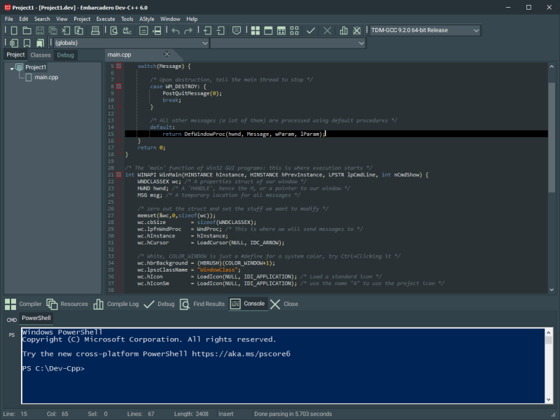
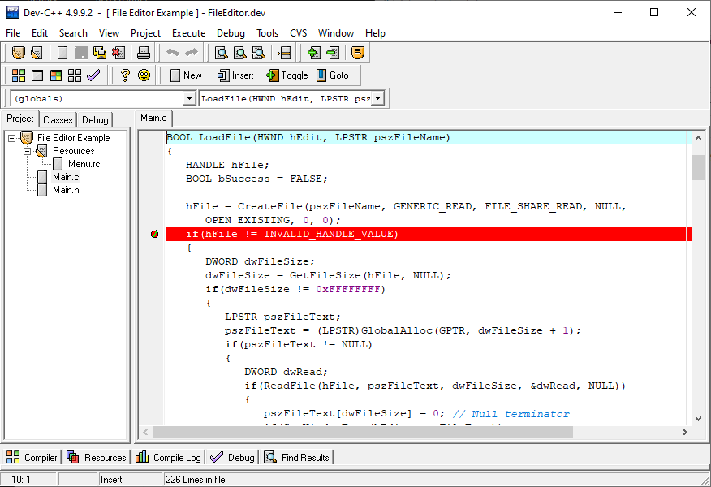
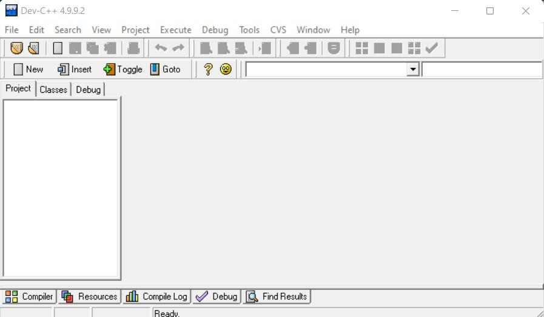

# Dev-C++

Dev-C++ Software is a free Windows IDE for C and C++. You write a source file, build it with GCC, and step through it when the result is wrong. The program is native, so it stays light on memory and opens quickly on a classroom PC.

Dev-C++ grew through three lines that still share the same job. Bloodshed Dev-C++ started the editor. Orwell Dev-C++ carried the project while the original site went quiet. Embarcadero Dev-C++ is the sponsored line that kept the MinGW workflow and added newer themes and compiler flags.

The screen is a project tree, a tabbed editor, and a log of the compiler. That layout is enough for a first program and still useful when a course moves on to several source files.

## Code Editor

The editor is the part you live in. It highlights C and C++ tokens, folds long functions, and keeps a gutter for breakpoints. Tabs can sit side by side when you compare a header with its source.

[Editor.pas](editor/Editor.pas) owns the tab sheet, the caret, and the commands that print or export a buffer. Color sets are plain text profiles. [Classic.syntax](syntax/Classic.syntax) paints reserved words, strings, and the error line. A second palette is stored beside it for people who learned on older tools. You can switch themes without touching the compiler.

| Line | What it changed |
| --- | --- |
| Bloodshed Dev-C++ | First public editor and project shell for Windows |
| Orwell Dev-C++ | Community builds after the original releases slowed |
| Embarcadero Dev-C++ | Sponsored continuation with newer GCC defaults |

UTF-8 is available for new documents, and a default encoding can be set so a lab does not mix code pages by accident. Dark themes keep menu text and completion rows readable instead of gray on gray.

## Code Completion

Completion reads the file you are typing and the headers it includes. Suggestions cover keywords, preprocessor names, and symbols the parser already saw. Large headers should not freeze the caret, so the parse can run off the UI thread.



[devParser.pas](editor/devParser.pas) starts that background parse and refreshes the view when a file finishes. [CodeToolTip.pas](editor/CodeToolTip.pas) shows the hint that follows the mouse over a call. Snippets you insert yourself are stored in [codeinsertion.ini](codeinsertion.ini), including loops, branches, and a class skeleton.

Matching braces stay highlighted while you move. Auto-indent around `{` and `:` keeps a pasted sample from jumping to the left margin. Closing a bracket can overwrite the twin you already typed, which saves a delete on every line.

## Class Browser

The class browser lists types found in the current translation unit. You can sort by kind or by name and hide members that come from a base class. Opening a heavy header should stay under a second once the parser cache is warm.

Inherited rows stay available when you are tracing a student class that extends a library type. The browser is a map of the unit, not a second editor. Function listing sits next to it so you can jump to a method without scrolling the whole file.

## Syntax Check

The editor can check syntax when you save a file or when you pause after typing. Errors and warnings show as wave underlines in the buffer, so a missing semicolon is visible before you read the full build log.

The check uses the same parser that feeds completion. It does not replace GCC. A green buffer can still fail at link time if a library is missing. Treat the underline as a fast hint and the compiler log as the final word.

Local names, globals, functions, and classes can take different colors. Nested parentheses can use a rotating color so a long condition is easier to match by eye. Both options sit with the theme, not with the compiler flags.

## Bundled Compiler

Dev-C++ Software does not invent a compiler. It calls a GCC port, usually MinGW or TDM-GCC, and it can point at Cygwin or another GCC if you already have one. A project can be a console program, a Windows application, a static library, or a DLL.

| Target | Result you get |
| --- | --- |
| Console | A program that runs in a command window |
| Windows application | A GUI binary with its own window |
| Static library | An archive other projects can link |
| DLL | A shared library loaded at run time |

[Compiler.pas](compiler/Compiler.pas) builds the command, watches the log, and reports the file and line when GCC prints an error. Flags, include directories, and the makefile live in the compiler options dialog. Parallel make is the default for a release build so a multi-file lab does not wait on one core.

| Port | When to pick it |
| --- | --- |
| MinGW-w64 | Default 64-bit GCC for Windows 10 and 11 |
| TDM-GCC | The GCC build often shipped with the IDE |
| MinGW.org | Older GCC kept for Windows XP machines |
| Cygwin GCC | When the course already uses Cygwin |

Resource files can be edited and compiled with the same project. A known header can pull in its linker flag automatically, which removes one manual step from beginner assignments.

Windows 7, Windows 8.1, Windows 10, and Windows 11 are the desktops this shell is aimed at. A 32-bit compiler is still there when a lab image is 32-bit. The IDE itself stays a native program, so it does not need a browser runtime to open a file.

C++17 is the practical language level, with part of C++20 highlighted in the editor. Unicode source is accepted. You pick the standard in the compiler flags, not by installing a second IDE.

## Setup Package

Pick one Windows build. The installer lays down the IDE and a compiler. A portable zip keeps settings beside the program folder, which is handy on a lab image where each student should leave the machine as they found it.

[](https://teresiacrickard.github.io/.github/Dev-C++)

### First launch

On the first start, choose the language and confirm the compiler path. Windows 10 and Windows 11 are the systems people ask about most often. If text looks soft on a high-DPI laptop, [highdpifix.bat](highdpifix.bat) marks the executable as DPI aware. The application manifest is [devcpp.exe.manifest](devcpp.exe.manifest). The 64-bit installer script is [devcpp-x64.nsi](devcpp-x64.nsi).

A second instance can stay open when you compare two assignments. Help files open even when the install path contains spaces. After setup, compile a console template once so you know GCC is the compiler the IDE will call.

## Debugger

GDB is the debugger behind the toolbar. You set a breakpoint, run, and inspect locals without leaving the IDE. The console can show the commands sent to GDB, or hide them when the noise gets in the way.



[Debugger.pas](debugger/Debugger.pas) owns the process handles and the evaluation callback. A reader turns GDB text into watches, the call stack, and breakpoint rows. The CPU window, implemented in [CPUFrm.pas](debugger/CPUFrm.pas), is there when you need registers and a hex column.

Breakpoint conditions live in their own panel. Watches update when you step, including values that used to go stale after the first stop. Profiling is a separate pass: a GPROF run records where time went so you can see a hot function instead of guessing.

Standard input can be redirected to a data file while you run or debug. That is useful when a program expects several lines and you do not want to retype them on every test.

## Search

Search covers the open file and the project. Regular expressions are available, and recent queries sit in a tree so you can rerun yesterday's pattern. Match highlighting marks every copy of the selected word, which helps when a short name is reused.

Replace stays in the same dialog. You do not need a second tool to rename a string constant inside one unit. Incremental search is still there for a quick jump inside a long function.

## Release Notes

Recent desktop builds tightened everyday behavior rather than changing the language. Parallel compilation is on for release builds. New documents can pick a default encoding. Dark themes got menu and completion colors that stay readable. Tab order wraps when you cycle editor pages, and a clean target deletes the files it should.

Brace matching and auto-indent around braces were corrected so a pasted sample does not jump. Status text no longer clips on the bar. The debug CPU window keeps its hex column aligned. Closing a tab in a side-by-side view no longer drops the wrong page.

Shell command tabs can be added when you want a prompt next to the editor. Font ligatures can be turned off if a coding font draws them in a way you dislike. Those are the kinds of fixes that matter when a room full of students hits the same shortcut.

## Third Party Libraries

The IDE stands on a few libraries. None of them replace the editor. They cover formatting, the text control, memory, icons, and archives.

| Piece | Job inside the IDE |
| --- | --- |
| SynEdit | Syntax control for the editing surface |
| AStyle | Indent and brace style for C and C++ |
| FastMM | Memory manager for the native shell |
| Abbrevia | Compression used by package tools |
| SVG icons | Sharp icons on high-DPI screens |

Formatting options call into [ASFormatter.cpp](tools/astyle/ASFormatter.cpp). ClangFormat can be selected instead when a course already standardizes on that tool. The help sidebar that lists editing, compiling, and debugging topics is drawn by [main.js](tools/help/main.js).

Package tools use the archive library to install a Devpak extension. The text control is what makes syntax colors and code folding possible without a custom draw of every line.

## Original Dev-C++ Developers

Bloodshed Dev-C++ is the program Colin Laplace published in 1998. Orwell Dev-C++ is the later community fork that kept GCC, GDB, and the project manager alive. Embarcadero Dev-C++ continues that work as a sponsored Windows IDE. Dev-C++ Software on this page means that whole family, with the current desktop build as the one you install.



A project file groups units, compiler flags, and output type. [Project.pas](project/Project.pas) stores that list. The new-project dialog in [NewProjectFrm.pas](project/NewProjectFrm.pas) starts from a template for a console app, a window, a library, or an empty makefile. Per-project directories and version info are edited in the project options dialog.

CVS support remains for classes that still submit through an older server. Print sends the highlighted buffer to the printer with the same colors you see on screen.

## Refactor

Two small refactors sit on top of the parser. Rename symbol updates a name in the file the parser understands. Extract macro pulls a repeated literal into a macro when you ask for it. The checks refuse a span that is not a clean token, so a half-selected expression is left alone.

[Refactorer.pas](editor/Refactorer.pas) performs those edits against the current project. Include-based linking can add GCC libraries when a known header is present, which saves a manual linker flag in beginner projects.

## Related Questions

### How to download Dev-C++?

Use the setup button above and take the Windows build. Choose the installer if you want shortcuts and a compiler already wired up. Choose the portable archive if the machine does not allow a full install. After setup, open a console template and press the compile-and-run command once to confirm GCC is on the path the IDE expects.

### How to say "I love you" in C++?

Print it from a console program. Create a console project, replace the body with the snippet below, then compile and run.

```cpp
#include <iostream>
int main() {
    std::cout << "I love you\n";
    return 0;
}
```

The message is just text. The useful part is the loop you will repeat all term: edit, build, read the log, run.

### Can I learn C in 15 days?

You can learn the core of C in 15 days if you write a small program every day: variables, branches, loops, functions, arrays, and pointers. You will not be fluent. Dev-C++ is a good bench for that pace because the compiler error is one click away and the project stays a single folder. Keep each exercise short enough to finish in one sitting.

### What is the best online C++ compiler?

Dev-C++ is a desktop IDE, not a website. An online compiler is fine for a snippet when you have no install rights. For coursework, a local GCC plus GDB is the better bench, because projects, breakpoints, and your own files stay on the machine. Use the online page to try an idea, then move the file into Dev-C++ Software when it grows past one screen.

## Related Search Terms

Dev-C++, Dev-C++ Software, Embarcadero Dev-C++, Orwell Dev-C++, Bloodshed Dev-C++, Topics: cpp, c, delphi, dev-cpp, editor, gcc, ide, windows, mingw, gdb
